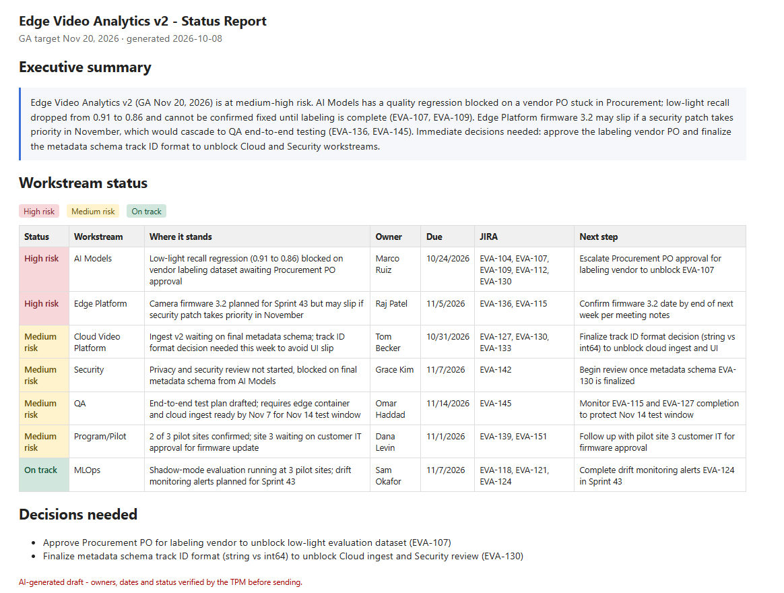

# AI Status Report Generator

A Python tool that turns a JIRA CSV export and meeting notes into a draft program status report: an executive summary, a color-coded status for each workstream (High risk / Medium risk / On track), and the decisions leadership needs to make.

> **AI-assisted project.** I built this with Claude to explore how a Technical Program Manager can use the Anthropic API in day-to-day program work. I designed the report format, the status rules and the "facts only" guardrails, and tested the output; Claude helped write the code.

## Sample output

The repo includes a sample project, "Edge Video Analytics v2," with made-up data: a JIRA export and meeting notes for a fictional release. This is the report the tool produced from them:



## How it works
1. Reads a JIRA export (`.csv`), meeting notes (`.txt`) and the project details (`project.json`)
2. Sends them to Claude through the Anthropic API with strict instructions: use only facts from the sources, never invent owners or dates (write "TBD" instead), and cite JIRA keys
3. Gets back structured JSON and produces:
   - a color-coded table in the terminal
   - an HTML report that opens in the browser

## Guardrails
- The model is told to use only the provided sources and mark missing owners or dates as **TBD**
- Every row cites its JIRA keys so it can be traced back to the source
- The report is labeled a **draft**: the TPM checks every owner, date and status before anything is sent
- Only run it on real company data if your company has approved sending that data to the API

## Run it on the sample
```powershell
pip install -r requirements.txt
# put your key in a .env file:  ANTHROPIC_API_KEY=your-key
python status_report.py jira_export_EVA_v2.csv meeting_notes_EVA_v2.txt
```

## Use it for your own project
Edit `project.json` with your release name, GA target and workstreams, or pass a different file as a third argument:

```json
{
  "project": "Edge Video Analytics v2",
  "ga_target": "Nov 20, 2026",
  "workstreams": ["AI Models", "MLOps", "Edge Platform", "Cloud Video Platform", "Security", "QA", "Program/Pilot"]
}
```

```powershell
python status_report.py my_export.csv my_notes.txt my_project.json
```

Optional: set `ANTHROPIC_MODEL` to choose a different Claude model.

**Tech:** Python · Anthropic API (Claude) · JSON · HTML
